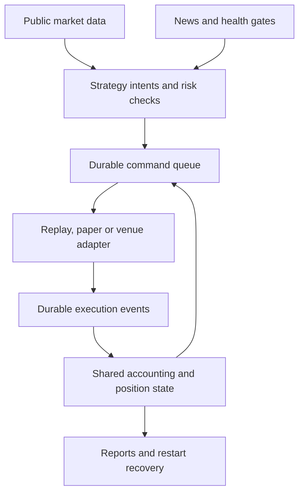

# Crypto bot: integrated release assignment

**To the Muse manager and five workers. This is the single replacement assignment.**

Date: 14 October 2026, Asia/Kolkata. Repository: https://github.com/sahajpatel123/crypto-bot. Verified starting main: `48029fb6753df8c775db45b59adb2f0d9c795a87`.

This document is self-contained. The owner does not need to supply the three preceding review files. Preserve previous evidence, code and accepted risk constraints; this assignment supersedes earlier task sequencing and incomplete implementation boundaries. Read applicable repository instructions and use the existing coordination mechanism.

## 1. The product you are responsible for delivering

Deliver one runnable, recoverable crypto trading application with one coherent trading lifecycle across replay, paper, Binance demo and guarded production. Complete the implementation of the production route during this assignment, while keeping real order submission disabled during development and validation. A later qualified launch must not require another coding assignment to replace a deliberate refusal stub.

The owner has a one-time intended allocation of ₹10,000, no assumed top-ups, and a Binance USD-M Futures account. Ledger and venue calculations use actual USDT amounts; ₹10,000 is not automatically 120 USDT. The desired holding period is 30–300 seconds. The architecture must support the Binance USDT perpetual universe through metadata rather than hardcoded BTC/ETH logic. Eligibility, liquidity, capital and measured throughput determine which instruments can actually trade.

Maintain the five implemented strategy families, but activate only individually qualified strategies. One evidenced strategy is sufficient for the first release; five implemented strategies are not five proven edges. The 2–3% daily account return remains an objective to measure, never a required number the bot must manufacture through extra orders or leverage.

**Manager owns the working product, not just dispatches and merges.** Every item below has a delivery condition. Resolve ordinary implementation problems and reassign unresponsive workers yourself. Do not wait for another CEO prompt to perform work already specified here. Do not represent incomplete signed exchange integration as merely missing credentials.

## 2. Why the previous workflow did not finish

Paper/replay tests and adapter tests proved different parts of the system without proving their connection. The live adapter's `bind_sink()` currently journals a message without binding a booking sink. Session records a fill but expects another component to book it. Its order-state logic also expects terminal entries in `open_orders()`, whereas the Binance implementation returns only currently open venue orders.

Separately, `src/cryptobot/cli.py::_run_prod` deliberately refuses every production run and says implementation comes later. That was an explicit scope limitation, not evidence of a finished live-capable application. Remove this development stub by implementing the guarded route, not by deleting safety checks.

Finally, the system lacks an economically qualified strategy. The last research task stopped after exporting candidates, leaving the forward-outcome measurement undone. Completing engineering and finding an edge are separate responsibilities; both require an explicit result.

Change the unit of delivery from a module or test count to a **demonstrated user operation**: start, reject an unsafe entry, place a permitted entry, book an actual execution event, verify protection, exit, recover and reconcile. Use the exact normal application path for these operations.

## 3. Architecture decisions: reuse and consolidate

Keep Python, the current lockfile, Nautilus 1.231.0, the existing strategy modules, risk rules, recorder/replayer, SQLite store and reporting. Choose one tested Python runtime for the release and record it. Do not introduce a new trading engine, microservices, Kafka, a language rewrite, an LLM in the order path, or a second ledger to work around these defects.

The application Session owns the trading lifecycle. Venue/simulator adapters own transport and simulated venue behavior. They emit normalized execution events; they do not independently decide application risk or mutate the application ledger. Nautilus may maintain its internal simulated venue state, which must reconcile with the application's accounting.

This is the target responsibility split, not a claim that the current code already implements it.

**One accounting owner.** A fill's unique identity, its ledger effect, reservation/exposure transition and resulting protection/exit decisions must follow one idempotent processing path. Do not repair the live adapter by adding an unrelated second booking path while leaving paper behavior different. Simulated callbacks must feed the same application path.

**Explicit adapter contract.** Extend the existing interface in `app/engine.py` with the smallest necessary changes. Distinguish (a) open orders, (b) tracked order status including terminal and unknown states, (c) normalized execution events, and (d) authoritative positions/account/margin snapshots with timestamps and completeness. A missing order in the open-order list is not proof of cancellation, no fill or flatness. Avoid ambiguous tuple meanings for wallet equity and available margin.

**Durable recovery.** Extend `app/store.py`, using one SQLite writer. Persist normalized execution events and command intentions before acknowledging application processing. Make state application/checkpoint cursors and pending commands crash-consistent. Use one transaction where applicable; never hold a database transaction across network I/O. A command that might already have reached Binance must be reconciled by its durable client ID before resubmission. Network delivery is not guaranteed exactly once; enforce idempotent application effects and reconciliation.

Fill identity must survive process/run-ID changes within the same live account ledger, while independent backtests remain isolated. Namespace events by venue/account/ledger instance, instrument and venue execution identity as appropriate. Order-state events need their own identity/version semantics; do not deduplicate all updates solely by client order ID. Out-of-order updates cannot roll cumulative filled quantity backwards.

Existing JSONL files and risk snapshots become reproducible views/checkpoints of the authoritative application history, or have an explicit recovery protocol. Do not silently combine disagreeing stores. Migrate existing state with a versioned reader and backup; refuse unsafe state instead of guessing. Configure and verify SQLite durability for the launch mode, including the distinction between process-crash and power-loss guarantees.

**Market data storage.** Keep the current proven raw capture format and checksummed manifests. Store derived research partitions in compressed, columnar files when useful. Preserve exchange event time, local receipt time, publication/availability time, sequence IDs and source provenance. Stream partitions with bounded memory. Do not write every market tick synchronously into the transactional execution ledger.

## 4. Required lifecycle behavior

The manager defines the shared event and adapter contracts first, then W1/W2 integrate continuously against them.

1. Before an entry, verify current instrument filters, feed/book quality, tradability, calendar/anomaly state, available margin, actual capital allocation, account mode and the absence of conflicting pending/open/unresolved exposure. Quantize quantity and prices before approval and recompute worst-case planned loss after rounding. Minimum size that exceeds the budget means skip.
2. Persist the reservation and command identity. Use the existing price-protected IOC entry. Check the band against executable bid/ask at arrival; an expired or unmarketable order cancels without resting. Never repair fill rates by silently widening the band.
3. Route fills from both private stream and REST reconciliation into the same event handler. Book quantity, price and fees once; reconcile cumulative quantities and convert the first filled reservation into exposure. Subsequent partial fills remain attached to that position.
4. Request stop protection immediately on confirmed exposure, then verify venue acknowledgement and effective covered quantity. Stop placement and verification are different states. Partial fills resize coverage without forgetting old legs or creating an over-close race. Independent stop/target legs must use the venue's appropriate reduce-only behavior; do not invent atomic OCO semantics.
5. If protection is rejected, delayed beyond its configured deadline or becomes insufficient, prevent new entries and reconcile/cancel the remaining entry. Attempt bounded risk-reducing closure of confirmed bot-owned exposure. Do not merely print FAIL and abandon an open position. If the venue cannot be reached, persist unresolved risk and raise an actionable alert; never claim an impossible guaranteed close.
6. Enforce the strategy's 30–300-second holding limit from actual entry exposure, with a defined treatment of partial fills. Stops, targets, time exits, operator stop and risk halts use the same lifecycle. Close requests are idempotent; terminal children remain tracked until confirmed.
7. Flat means agreement among venue positions, fills, ledger, risk exposure, reservations, pending commands and tracked children. A zero local cache is insufficient. Reconcile actual fees and signed funding if a position spans a settlement; short holding time alone does not imply zero funding.
8. On restart, acquire a single-instance/account lock, load durable state, restore indicator state, reconcile venue truth and resolve uncertain commands before accepting entries. Refresh stale books/quotes and rewarm only what cannot be recovered correctly. A restart must not reset daily loss limits, profit high-water marks or trade ownership.

For errors, implement behavior by documented Binance message/code: distinguish a definite rejection from unknown execution. Back off on rate limits and protect capacity for cancellation/reduction. Never retry a possibly executed entry as a new order just because the HTTP response was lost.

**Production route completion.** Wire production to this same driver with production host pinning, local secret references, current account equity/positions/fees, valid strategy/risk configuration and release evidence matching that configuration. Default-off submission remains. Missing credentials, qualification or reconciliation produces an explicit non-success state. Offline tests must prove both the refusal paths and the real submit path through an injected transport. Do not make actual production requests that place, cancel or amend orders during this assignment.

## 5. Data, speed, coin selection and news

Use asynchronous I/O and bounded queues. Slow HTTP/calendar/reporting work must not block risk supervision or exits. Preserve order-book sequence integrity; do not silently drop depth differences under load. Overload degrades eligibility and stops new entries while maintaining exposure management.

Scan the exchange's tradable USDT perpetual metadata at a bounded cadence. Rank eligible instruments using observable liquidity, spread, depth, recent volatility and capital/filter feasibility. Start with at most two active high-frequency subscriptions because the previous measurements did not support eight. Expand only after a bounded measured workload passes. Rebalance subscriptions without dropping management of an existing position. Test a non-BTC/ETH fixture with different quantity/price precision to prove generality. This supports different coins without promising every listed instrument is safe or affordable to trade.

Report separate timings for event age, local queue delay, feature/strategy calculation, risk-to-command, transport acknowledgement, fill notification and stop confirmation. Do not call a strategy-function timer total order latency. Record sample counts and p50/p95/p99/max with clock domains. Retain the existing local p99 target as a measurement goal, not a fabricated pass. Readiness uses strategy freshness/expiry and exposure deadlines under the actual tested load.

Wire the existing FOMC/CPI calendar and anomaly gates into the normal protected run configuration. Include BLS Employment Situation coverage in the same interface if it is absent; verify dates from official sources, including timezone/DST and revisions. A locally loaded fixture does not become freshly verified data. Missing/unverified coverage follows the protected-profile no-entry policy while exits remain available.

For scheduled releases, preserve the existing configured blackout windows and stop admitting trades early enough that their maximum hold and orderly exit fit before the blackout. Use known event timing and fresh calendar evidence in live operation; historical evaluation may use only information available at that historical time. Do not demand today's calendar freshness for an otherwise properly archived historical run.

Unscheduled news cannot be predicted reliably. Use measured price jumps, spread widening, book thinning, feed delay and exchange faults to suspend entries. Keep exits supervised. A paid news service or an LLM is not a dependency for this release, and a headline sentiment score must not bypass risk gates. Do not advertise comprehensive news awareness.

## 6. Economic work: complete the existing question, then make a finite decision

The reviewed export contains 61 ETHUSDT candidates: 16 S1 and 45 S3. Median projected target distance is 4.87 bps overall. Under the export's assumed 10-bps round-trip commission, 56 targets do not cover commission alone. All 45 S3 targets are below that fee assumption. These are target/cost diagnostics, not realized outcomes or probability-weighted expectancy.

The frozen selector variants admit at most 0 candidates at a 1.0 cost multiple, 0 at 0.75 and 1 at 0.5. Replaying zero-candidate cells repeatedly is wasteful. Validate this analytic shortcut against the selector and preserve the frozen variant definitions and count results.

**Finish H-R2 now.** Reassign the stalled worker's task; do not reopen its planning stage. Extract causal entry and forward execution windows from the manager's local raw captures once. Account for all 61 candidates with a filled/partial/unfilled/unscorable outcome. Measure original stop/target/time-exit outcomes and predeclared 30/60/120/300-second markouts. Preserve latency, IOC bands, sizes, book availability and exit ordering. No oracle exit time, invented history or favorable candle assumptions.

Label rejected-candidate outcomes counterfactual diagnostics. They are not portfolio P&L. Overlapping candidates, cooldowns and the one-position rule must be enforced in the subsequent portfolio test. Missing required data remains unscorable. These reused captures remain development knowledge.

**Calibrate the economic model.** Separate fees, executable spread, impact/slippage, latency and funding. Account-specific commission is authoritative when securely available; otherwise retain explicitly labeled assumptions and sensitivities. Bid/ask simulated fills already contain spread; do not charge it again. Latency-induced price changes in arrival fills must not also be blindly charged as the same slippage. Conversely, top-of-book data cannot justify unlimited size or zero impact. Quantify model limitations.

Use expected net outcome conditional on the tested setup, rather than projected reward distance as a substitute for expectancy. Estimate win/loss magnitudes and probabilities from appropriate data with uncertainty, not an LLM confidence score. The sample cannot establish reliable probabilities merely because it has many overlapping ticks.

**Strategy decisions for this release:**

| Family | Role in the release |
|---|---|
| S1 breakout momentum | First candidate for a cost-aware, volatility-conditioned continuation test |
| S2 trend pullback | Second candidate where pullback/resumption can improve entry economics |
| S3 range/VWAP reversion | Current taker configuration unqualified; complete diagnostic before any redesign |
| S4 failed-breakout reclaim | Retain implementation and results; require its own qualifying evidence before activation |
| S5 order-flow continuation | Eligible only with synchronized book/flow history and its own economic evaluation |

If the completed diagnostic does not qualify the old configurations, execute **one bounded new development round**, not an open-ended search. Prioritize S1/S2; cap the round at six predeclared configurations in total, including their unchanged controls. Use economically motivated volatility/regime and 120/300-second horizon variations selected before viewing their outcomes. Stops and targets must correspond to the setup's invalidation and measured opportunity, not be moved simply to satisfy the cost floor. Record every attempted configuration and all rejected results. This is a research hypothesis, not a claimed profitable recipe.

A maker-entry alternative is not an automatic fee fix: it needs historical queue/fill and adverse-selection evidence. Do not add it to this deadline's scope without that evidence, and do not assume a touched limit order filled.

Before the new round, W3 supplies a data-suitability table: instrument, period, provenance, trade/book/mark/funding coverage, gaps, availability timestamps and whether any team member has already used its outcomes. Minute-cadence marks cannot validate a one-second freshness rule; do not manufacture high-frequency observations by relabeling forward-filled marks. Coarse data can screen a hypothesis only, with that limitation stated.

Use chronological development/validation and one untouched evaluation for the selected candidate. Purge/embargo shared lookback, trade horizon and label dependence at split boundaries. Count all selection attempts. Rerunning an untouched test to select parameters contaminates it; mechanical reruns must preserve identical configuration and be disclosed. The new round is complete when the evidence accepts, rejects or cannot evaluate its hypothesis, not when the daily-profit target appears.

Preserve the existing qualification screen: at least 100 closed out-of-sample positions spanning at least ten days, plus positive net evidence under realistic/adverse costs and acceptable risk. It is a minimum, not a proof. Report day/capture clustering, effective sample limitations and selection effects; a thousand correlated trades do not equal a thousand independent trials. If data cannot meet this screen, do not lower it. Existing genuinely untouched suitable history can avoid waiting ten new calendar days; new agents cannot manufacture such history. Complete all available analysis and label qualification DATA BLOCKED if it truly is.

Report gross/net return, expectancy, win rate, average win/loss, profit factor where defined, fees, spread/impact attribution, funding, fill rate, turnover, holding periods, drawdown and performance concentration by date/instrument/regime. Include CASH and unchanged baseline. Net-of-trading-cost results do not imply net-of-subscriptions, hosting, conversion costs or taxes; present those separately when known.

## 7. Capital policy and selector behavior

Keep the intended conservative first-pilot profile. Planned loss per trade is at most 0.125% of the bot's current allocated equity, including stressed transaction costs. Quantity is constrained by the smallest of per-trade risk, remaining daily budget, fee-netted profit-floor cushion, available margin and instrument limits. Use at most 3x leverage and one global pending/open/unresolved position. Leverage is chosen after position risk/size, not increased automatically because a stop is tight.

Daily operating halt: 0.5%. Emergency escalation: 1%. Arm 70% profit retention after a 1% daily gain; pause new entries at 2%. Use flow-adjusted, fee-inclusive equity, conservative realizable exit value where applicable and the Asia/Kolkata day. Define and test threshold precedence and crossings during an open position. Persist the high-water mark across restarts. Do not invent an unrequested cumulative stop, but do not reset accumulated capital loss by pretending each restart restores the initial balance.

At ₹10,000, 0.125% is approximately ₹12.50 planned risk, 0.5% is ₹50 and 1% is ₹100 before currency-conversion effects. These are planning/action thresholds; slippage, gaps or venue failure can exceed them. The application must never label them guaranteed maximum losses.

No martingale, averaging down to recover a loss, loss-recovery quota or automatic widening of stops. Risk shrinks with equity. Profits can increase capital only through reconciled equity and the same percentage limits. Multiple strategies compete for one risk budget; do not sum contradictory signals or confidence scores. Freeze the selector used for qualification and default to no trade when none qualifies.

## 8. Five workers, one manager-owned integration path

Keep the present six-agent setup. Manager owns `cli.py`, shared interface decisions, release configuration, integration and the final launch package. Workers agree on interface changes through the manager before landing them; file ownership is explicit.

| Owner | Main ownership | Must demonstrate |
|---|---|---|
| W1 — trading core | Session, application ledger/risk, RunStore/recovery | A real adapter event changes the authoritative ledger once, drives protection and survives restart |
| W2 — exchange connection | Binance/paper adapter boundaries, private stream, demo drill | Same contract across adapters; user-stream/reconcile recovery; no duplicate entry; command-level failure semantics |
| W3 — data and operating conditions | Discovery, capture/replay suitability, market-data quality, calendar/anomaly integration | Suitable causal datasets and eligible instruments; bounded ingest; operational gates wired to the real Session |
| W4 — economic decision | Strategies, research runner, cost attribution, selector evaluation, economic report | Completed H-R2 and, if needed, the single bounded development round with a reproducible decision |
| W5 — independent verification | Cross-component acceptance tests and release checks | Challenges the actual integrated path; does not pre-book away the bug or accept a worker's claim without reproduction |

Manager provides the minimal interface decisions, then integrates W1/W2 first while W3/W4 run data/research work in parallel. W5 writes the integrated challenge early and reviews successive integrated checkpoints. Tests belong to their named owner or get distinct filenames to avoid shared edits.

A worker becomes unavailable after the existing bounded communication attempts: reassign immediately to another responsive worker or the manager. No final handoff may list executable work as waiting for an idle/unresponsive employee. Do not require the owner to paste messages into each worker session.

## 9. Execution order and observable deliverables

**Checkpoint A — one complete offline trading lifecycle.** Freeze the starting SHA and source/config identity. Integrate the actual Binance adapter with injected venue responses into the normal Session. Starting from an approved intent, demonstrate a fill, correct ledger/risk/fees, verified stop, partial exit, final exit, sibling termination and reconciled flatness. Repeat with a restart at exposure. A synthetic forced intent is allowed only as a labeled mechanics fixture; it provides no economic evidence. This is the first integration result, before another broad strategy matrix.

**Checkpoint B — complete application commands.** Implement guarded production wiring, private stream, durable restart, runtime stop/flatten, calendar/anomaly enforcement and useful status/report output. Normal operator commands must support doctor/readiness, replay/backtest, paper, demo, production-preflight, gated production start, status, stop/flatten, resume and report. Reuse existing syntax where possible; do not invent a second CLI. Record the exact installed commands and prove them from a clean locked environment. No `/tmp` trial venv path is an operator prerequisite.

**Checkpoint C — economic report.** Finish H-R2 and the bounded round if needed. A single readable HTML/Markdown report must show what the bot evaluated, why it traded or declined, how much it made/lost after each cost, how fills were modeled, sample size and qualifications. Freeze any selected strategy and selector before untouched evaluation. If none qualifies, ship the working research/paper product with an explicit rejected/insufficient economic result. Do not keep cycling through software changes to conceal that result.

**Checkpoint D — bounded venue demonstration and release.** After A/B pass, run an owner-environment Binance demo session if demo credentials are available. The routine strategy may produce no signal in 25 minutes; use a clearly labeled, demo-only scripted intent through the same Session/risk/order path to prove mechanics. It may not bypass sizing, freshness or protection. Pick a liquid eligible instrument whose real filters fit the existing demo notional cap; do not raise the cap to force a trade. Use a genuinely marketable capped IOC based on bid/ask, not a deliberately far-away limit. No fill means no round-trip proof, not success.

Prove entry/protection/exit and private-stream interruption/recovery with venue acknowledgements. Reconcile positions, orders, fills, fees, margin/equity and local state. Demo P&L is not real-market profitability evidence. If credentials are absent, provide the complete, already offline-tested command and secure environment-variable instructions; all other implementation and research work continues.

The final release must have no known missing code on the ordinary trading path. Missing economic evidence or owner-held credentials is reported separately from unfinished software. Do not call the software complete while the private reader, production route or equity reconciliation is deferred.

## 10. Bounded execution and focused verification

No continuous job may exceed 30 minutes, including setup, subprocesses, grace periods and cleanup. Plan at most 1,500 seconds of work and retain the remainder for safe shutdown/checkpointing. Reuse the current budget wrapper only where descendant enforcement is verified. Do not disguise continuous monitoring as automatic restarts, and do not revive owner-stopped runs.

Large historical research may be partitioned into finite jobs using existing restart-equivalence support. Persist event cursors, indicator history, reservations, exposure, costs and risk state. A checkpoint is not permission to assume flatness. Independent agent jobs can run concurrently within machine memory/CPU limits; stop oversubscription that distorts the feed or timing evidence. This time limit is a wall-time constraint, not a rule limiting historical data to 30 minutes.

For order-bearing demo work, stop entries by minute 20 at the latest and complete closure/reconciliation within the work budget. Do not rely on process kill to close an exchange position. On unreachable venue state, persist unresolved risk, block further trading and alert with the exact known IDs/exposure; honest unresolved risk is preferable to a false flat verdict.

Targeted tests during edits, one integrated suite at release, and extra tests only for a concrete failure or required gate. Do not rerun the full suite on every message, commit empty coordination changes every turn, or generate repeated reports for inactive strategies. Measure completed operations and resolved economic questions, not commit/test counts.

Required integrated challenge cases:

| Case | Required result |
|---|---|
| 0.001 BTC synthetic fill, 0.03 USDT fee | Ledger and booked risk show 0.001; fee booked once; protective order requested and verified |
| Filled entry absent from venue open-orders list | Still resolved as filled and protected through tracked-order truth |
| Duplicate/partial stream plus REST fill | No double-booking, missing exposure or excess protective quantity |
| Response lost after entry acceptance | Query original client ID, adopt outcome, no duplicate risk-increasing order |
| Crash at submit, fill and protection boundaries | Restored state agrees with venue; commands safely reconciled |
| Stop failure or private-stream gap | Entry halt, bounded protection/reduction/recovery; unresolved status persists if needed |
| Preflight failure or missing keys | No entry phase; no overall PASS for required BLOCKED phases |
| Restart with an unresolved order | Non-success until resolved; never PASS merely because local open list is empty |
| Venue position with empty local order cache | Not flat; reconciliation finds discrepancy without touching foreign exposure |
| Loss/floor crossing, deposit, day boundary, restart | Correct flow-adjusted risk action and persistent high-water state |
| Stale book, overload, upcoming news, invalid calendar | No new entries; exits and operator control remain responsive |
| Deadline with reparented child | Verified containment on launch platform or refusal to run there |

The previous independent Linux suite had 1,155 passes, five deadline-related failures and three skips in 201.68 seconds; one daemon survived. The manager's macOS/Colima suite was different. Preserve both observations. Certify one intended launch environment and record limitations; do not weaken assertions or call `UNVERIFIED` verified.

## 11. Release verdicts and the end of this assignment

Deliver one integrated commit/release candidate, locked setup instructions, one operator runbook, the required integrated challenge results and one economic report. Keep durable evidence under the repository's reports/run structure, with large data outside git and referenced by hashes. Every result identifies code/config/data/model assumptions. Reports should answer ordinary owner questions directly: current state, exposure, stop coverage, net P&L/costs, reasons for no trade, and the next required operator action.

The final status must distinguish:

| Verdict | What it proves |
|---|---|
| Software complete | No missing application-path code; shared lifecycle, CLI, durability and failure behavior verified in the declared environment |
| Demo validated / blocked | Credentialed venue mechanics observed, or the exact outstanding external dependency |
| Strategy qualified / rejected / insufficient | Economic result on suitable data with disclosed uncertainty and untouched evaluation |
| Production activation eligible / ineligible | Required software, venue, economic and current account checks all agree for the exact release |

Production stays off during this assignment. Prepare the concrete launch command and configuration after all implementation work; do not ask the owner to approve an abstract future build. A qualified activation uses the existing owner's launch/credential workflow and the same completed code path. Never alter host guards or economic rules to make the switch pass.

If no strategy qualifies, the outcome is a functioning application with a rejected or insufficient strategy result, not a claim of profitability. If suitable held-out data is absent, identify its exact required fields/period and any verified available source; do not fabricate it. If implementation is unfinished, say which product operation still fails. There is no honest instruction that guarantees a profitable strategy by a coding deadline.

Do not end with “ready for the next directive” while any specified, executable task remains. Complete the controlled work, close the economic question to the extent the available data permits, and return the release with evidence and precise remaining external dependencies. No additional CEO design round is required to execute this assignment.

## Source notes

Repository observations are from the verified SHA above and the preceding independent run. Architecture and future behaviors in this assignment are design requirements, not claims of completed implementation. Current official references checked for this assignment:

- Nautilus architecture and command/event responsibilities: https://nautilustrader.io/docs/latest/concepts/architecture/
- Binance USD-M general API behavior, errors and limits: https://developers.binance.com/en/docs/products/derivatives-trading-usds-futures/general-info
- Binance user-data stream lifecycle: https://developers.binance.com/en/docs/catalog/core-trading-derivatives-trading-usd-s-m-futures/api/rest-api/user-data-streams
- Federal Reserve FOMC calendar: https://www.federalreserve.gov/monetarypolicy/fomccalendars.htm
- BLS release calendar: https://www.bls.gov/schedule/news_release/current_year.asp
- BLS Employment Situation schedule: https://www.bls.gov/schedule/news_release/empsit.htm

Verify endpoint details against the installed adapter/version and current official documentation while implementing. No reference here establishes that the proposed strategy is profitable.
