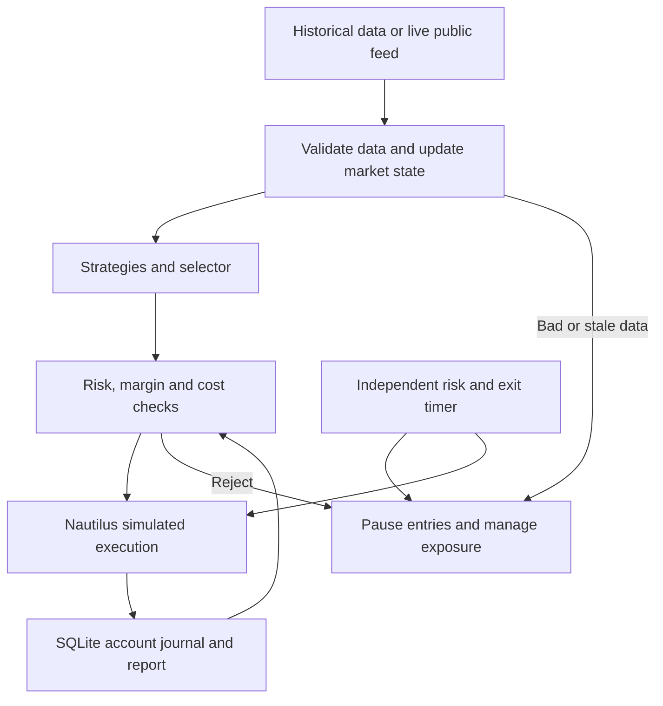

# Crypto bot: complete the bot, backtest it, report its performance
CEO work order for the Muse manager and the same three workers  
Baseline reviewed: 8d31ead4e90fa972addd950b1c2552a7c2e8f214  
Issued: 12 October 2026, Asia/Kolkata

## The simple goal

Deliver one complete trading application that can replay real historical markets, make decisions, manage a simulated account and produce an understandable performance report.

We will judge progress through three outcomes:

| Outcome | What the owner receives |
|---|---|
| Complete bot | The same trading logic and execution model work in backtest and live-feed paper mode, with all usable strategies connected. |
| Trustworthy backtest | A reproducible run on real market data, including risk limits, overlapping signals, realistic fills, costs and account equity. |
| Clear performance report | A readable report showing whether it earns or loses money, why, how much risk it takes and what remains uncertain. |

Keep internal coordination details with the manager. Tell the owner which outcome is complete, show its result, and identify the next executable action. Do not use Q/V/E labels as the main explanation of progress.

The current bot contains substantial real code. The CEO review verified all 229 snapshot files, reproduced 472 passing tests with 5 skipped in the light environment, then installed Nautilus 1.231.0 in an isolated review environment and reproduced all 534 tests. This verifies the supplied baseline’s tests; it does not establish profitable trading.

The current return-scoring script generates fixtures and evaluates each signal independently. Its 810/445 signal-trades are synthetic diagnostics, not a historical account backtest. Retain them with accurate labels; they cannot represent the account’s daily profit or the combined bot.

## 1. Complete the trading loop

Keep Python, pinned NautilusTrader 1.231.0 and the current modular codebase. Do not start a new framework or rewrite the project.

The request flow must be:



Every position must have one strategy owner, an explicit exit policy and reconciled account state. Preserve the one-global-position rule including pending/unresolved orders.

First fix these concrete gaps before trusting economic results:

| Gap at the reviewed baseline | Required behavior |
|---|---|
| Replay configuration says Nautilus, but Session creates ReferenceEngine. The replay CLI supplies no native engine. | Backtest and paper instantiate the same approved Nautilus execution implementation and policy. Reference/FakeVenue remain explicitly selected fault-test tools, excluded from economic benchmark results. |
| note_mark creates an executable quote with bid=ask=mark and nominal size. A CEO probe with real BBO 59999/60001 filled a buy at 60000 after a mark update. | Mark/reference price updates valuation only. Captured-data fills cross actual bid/ask and available liquidity. No artificial zero-spread quote drives an economic fill. |
| Historical session calls can mix event-time replay with wall-clock mark updates/restamping. | Historical replay uses one deterministic virtual clock. Live mode uses documented receipt/availability timing. Preserve exchange times, ordering and stale-input evidence; never make an old quote fresh by changing a timestamp. |
| Failed attach_protection leaves protected=True and legs=[] while exposure remains open. This was reproduced through Session. | Protected means required stop quantity is acknowledged and verified. On failure: block entries, retain unresolved exposure, retry within a bound or attempt a reduce-only emergency close. Never falsely mark protection successful. |
| run_live checks timers, heartbeat, stop and duration only inside the event iteration. A 0.05-second deadline completed after 0.262 seconds when the next event was delayed. | Timers and operator controls run independently of feed arrivals, reconnect sleeps or REST work. Test a silent feed, stop request during silence and an expiring holding deadline. |
| S5 receives depth=None and flow=None; _ingest ignores depth/markPrice channels. | Supply synchronized book/flow views to S5, correct mark-based valuation and settlement/funding events to accounting. Ineligible windows carry precise reasons. |
| Available-margin fields exist but Session does not supply them; replay/run filters differ. | Supply available/free margin, in-flight reservations and fee buffers from the simulated account. Apply explicit instrument-filter profiles in both modes. Align simulator leverage with the configured risk model. |
| Project dependencies omit Nautilus; native paper commands rely on a temporary trial environment and PYTHONPATH. | Declare and lock the actual trading runtime, run it from the project environment and prove installation from a clean checkout. |
| Existing reports give aggregate cash/costs but lack an equity curve and position-level performance dataset. | Persist the account curve and complete position episodes so performance metrics can be rebuilt independently. |

Also enforce entry bounds after modeled delays. A risk-sized entry band is not a valid bound if an unprotected MARKET order fills anywhere after a price jump. Use a verified price-protected marketable IOC or equivalent supported policy; reject/expire the opportunity when permitted bounds cannot be honored. Emergency exits keep realistic adverse prices and nonzero modeled costs/delay.

Use strict current data-quality/freshness checks and preserve gap flags. Market history must not be silently compressed by removing missing seconds.

Improve the measured ingestion bottleneck: isolate network/snapshot reads, use bounded queues/history, and profile serialization/persistence. Critical approvals, fills and risk transitions stay durable; do not fsync an unchanged health timestamp for every BBO update. Report queue lag and actual healthy coverage rather than concealing stale events.

### Strategy cards

Keep the agreed five families:

| Strategy | Intended opportunity |
|---|---|
| Breakout momentum | Price leaves a recent range with directional momentum. |
| Trend pullback | A pullback ends and the established trend resumes. |
| Range reversion | Price moves back toward the range’s reference value. |
| Failed breakout reversal | A breakout fails and price reclaims the earlier range. |
| Order-flow continuation | Real directional trade flow and synchronized book evidence support continuation. |

For each, provide a short exact card: inputs, long/short setup, trigger, rejection conditions, entry bounds/expiry, invalidation, stop/target/time exit, holding range and parameter units. Cards describe the implemented rules; they are not evidence the strategy works.

Wire every available family into the app. Where the chosen dataset lacks a required feature, report the strategy as ineligible on that dataset. A strategy appearing in a config is not proof it ran.

Correct cost admission: the selector must compare the planned gross reward with explicit round-trip cost estimates, not just check whether a cost number is below 25 bps. Positive reward potential is a necessary feasibility check, not an invented expected-value or win-probability estimate.

## 2. Run a real account-level backtest

### One engine, one account policy

Implement a backtest command that runs the whole bot, not a separate function that scores every signal independently.

It must replay events through the normal strategy, selector, risk, order, position and accounting path. It must enforce cooldowns, one position, entry expiry, sizing, minimum sizes, margin, stops, target/time exits, daily pauses/halts and global profit protection.

Keep deterministic inputs, configuration, data/code fingerprints, random seeds and virtual time. Re-running a fixed benchmark must reproduce its fills, account curve and metrics. UUID-like display IDs can vary only if the stable event identities/results remain comparable.

Never add independent per-signal bps together and call that whole-account return. Never fill a delayed entry at a future bar’s closing price selected using that bar’s full high/low.

### First datasets and honest confidence

1. **Run the corrected bot now on the owner’s retained cap-30min/cap-2h data.** Use actual trade/BBO/depth/snapshot records when retained. Produce the first full account report immediately. These short windows test the backtest and execution pipeline; they cannot validate alpha.
2. **Build a frozen 30-accounting-day BTCUSDT/ETHUSDT benchmark using official Binance public historical data.** Initial date target: 12 September–11 October 2026, complete Asia/Kolkata days. Acquire adjacent UTC archive files needed to cover those day boundaries. Freeze file URLs, checksums, coverage and missing periods before evaluation. If the newest required archive is unavailable, use the latest fully covered 30-day window and record that availability-based choice before scoring.
3. **Check actual historical quote/depth availability.** Do not invent historical book state. If the archive provides only trades, use a separately labeled research execution/spread assumption profile and sensitivity analysis. It is lower-confidence than replay with observed quotes/depth; S5 requiring absent depth remains ineligible there. Never present estimated BBO/depth as observed data.

BTC/ETH are the initial benchmark and current measured runtime scope, not a permanent coin whitelist. Retain dynamic supported-coin discovery; expand only after throughput and data coverage are demonstrated.

Download resumably, verify published checksums, parse timestamp/side/volume semantics, identify duplicates/gaps and retain immutable dataset manifests. Stream/chunk large datasets rather than loading a month of ticks into a Python list.

Use historical instrument metadata when available. If past filters are unavailable, freeze and label the assumed filter profile; today's exchange rules are not silently historical facts. The backtest must run offline after data preparation, without fetching current prices or filters during replay.

Storage:
- Immutable compressed raw archives and metadata/snapshot manifests.
- Normalized Parquet data partitioned by symbol/date/channel, with observed versus modeled fields explicit.
- SQLite WAL for run state, intents, fills, funding, risk transitions and reconciliation checkpoints.
- Per-run result files and one report index.

Avoid a distributed database or new cloud service. Preserve existing research data.

### Evaluation sequence

Freeze the five BASE strategies and current selector. Run:
- Each strategy separately under the same account/risk policy.
- The combined bot with the one-position rule.
- Cash/no-trade as the zero-return reference.

Report all results and all ineligible/zero-trade cases. No parameter search in this first baseline comparison.

For the 30-day benchmark, use the earliest 15 days for development, the next 7 for validation and the final 8 for untouched test results. Freeze exact boundaries. Purge overlapping entry/holding outcomes and define causal warmup; trades from one scored window cannot leak their labels into another.

All bug fixes or research variants are logged. Changes made after inspecting a test period require a new future untouched period; do not repeatedly reuse the same test days and claim they remain unseen. Chronological splitting alone does not erase multiple-testing bias.

After the baseline, allow one bounded improvement round on development/validation data. Identify the actual failure—cost burden, poor entry timing, bad exit, signal overlap or data regime—and test a small registered change. Preserve the losing baseline. Do not force a profitable result or increase leverage to hide negative expectancy.

Costs must be consistent:
- Commissions on each actual modeled fill.
- Spread and book-walk/slippage already reflected in executable fill prices are not deducted again.
- Any additional adverse-fill allowance is explicit and separately labeled.
- Signed funding at its real settlement time when applicable, with rates/intervals sourced or explicitly assumed. A short trade does not automatically pay an 8-hour funding charge.
- Nonzero modeled entry/exit latency, including urgent exits; configured delay is not a measured Binance acknowledgment.
- Base and predeclared adverse cost/delay profiles on validation.

Keep portfolio profit-protection policies active in the main comparison. Policy ablations, if needed, are separate recorded research comparisons.

## 3. Produce one understandable performance report

The new CLI targets below are requirements to implement, not commands claimed available now:

```sh
uv sync --locked --extra dev
uv run --locked cryptobot backtest --dataset datasets/captured.toml --config configs/benchmark.toml --out reports/captured_baseline
uv run --locked cryptobot backtest --dataset datasets/benchmark_30d.toml --config configs/benchmark.toml --out reports/benchmark_30d
uv run --locked cryptobot report --run-dir reports/benchmark_30d
```

The backtest command should generate the report automatically; the report command rebuilds it from persisted results.

Required artifacts: summary.json, trades.csv, equity.csv, daily_returns.csv, rejections.csv and a standalone report.html with embedded charts. No website deployment is required.

| Metric | Required meaning |
|---|---|
| Net account return | Flow-adjusted whole-account return after modeled costs, with ending open exposure/close-cost assumptions shown. |
| Net expectancy | Average net USDT profit/loss per completed position episode, with sample count and uncertainty. |
| Maximum drawdown | Largest peak-to-trough account decline in USDT/% using the account curve, including open losses. |
| Win rate and profit factor | Net winning-position fraction; net gains divided by absolute net losses. Undefined denominators are labeled, not shown as a fake favorable score. |
| Trading behavior | Completed positions, fills/partials, exposure time, holding distribution, exit reasons, long/short and strategy attribution. |
| Cost burden | Entry/exit commissions, signed funding and separately explained execution effects; reconcile to the ledger without double-counting. |
| Daily target evidence | Mean/median/best/worst daily account return and fraction of ALL full accounting days reaching 2%/3%, including no-trade days. |
| Reliability | Stale/gap periods, rejected intents/orders, protection gaps, risk violations, restarts, lost events and actual healthy duration. |
| Speed/resources | Queue wait, strategy/selection/risk/dispatch timings p50/p95/p99, measured versus modeled delay, CPU/RAM/disk. |

Show an equity curve, drawdown curve, daily returns and per-strategy comparison. Each chart states its dataset and sample window.

Separate development, validation and untouched-test results; captured full-microstructure results, archive assumption-based results and forward paper results must not be blended. Do not annualize a short-window return into a sales claim. Use day/time-block uncertainty when appropriate; short samples are labeled insufficient.

The first page answers:
1. Did this tested version make or lose money after costs?
2. How large was the worst account decline?
3. How many completed positions support that result?
4. Which strategies helped, hurt or lacked data?
5. What fails under worse costs/delays?
6. What must improve next?

Every metric must reconcile to position episodes, fills, funding and account cash. Partial fills are not extra trades. End-of-data artificial closes, gaps or forced test interruptions are separately identified.

### Continue paper testing

After the trading-loop fixes and real captured-data backtest pass, launch a supervised local paper session from the normal project environment. Start with a verified one-hour run, then launch the 24-hour run as a persistent process independent of the agent turn timeout.

Do not hand ordinary authorized launching back to the owner just because a foreground tool cannot wait 24 hours. Use a verified local supervisor and session-scoped keep-awake if needed. If the platform actually forbids persistence, give the exact tested blocker and the smallest required owner action. Never claim 24 hours elapsed before it does.

Backtesting work continues while paper time passes. Keep controlled fault injection separate from the untouched operational performance record.

## Ownership and completion

The manager owns integration and one current progress board with the three outcomes above. Use the same workers:
- Data and execution worker: normal runtime installation, live/historical data, clock, quotes/depth, Native execution and independent timers.
- Strategies and backtesting worker: five strategy cards/adapters, shared portfolio backtest, frozen comparisons and bounded research.
- Risk and reporting worker: protection/margin/funding invariants, independent result reconciliation, metric calculations and report outputs. Another worker/manager verifies that worker’s risk changes.

Keep separate worktrees and exact ownership; manager resolves shared interfaces and performs final integration. Routine local implementation, public downloads, tests and scoped commits remain authorized. Respect real CLI permission boundaries; verify worker activation instead of pretending an inbox file started it.

Done means:
- Normal locked installation and CLI work without /tmp environment paths or manually set PYTHONPATH.
- Proven gaps above are fixed with business-behavior regressions; the main suite includes native execution tests.
- An actual captured-data portfolio backtest and its report have run.
- The frozen 30-day benchmark has run, or a precise dataset availability/resource blocker is demonstrated with partial coverage labeled; do not quietly call a shorter sample 30 days.
- Strategy/combined/cash results and full metrics are readable and reproducible.
- Paper runs are actually launched/statused, with current measured duration.
- The owner receives final SHA, runnable commands, report paths, dataset coverage and one next decision in plain language.

The owner's ₹10,000 capital goal, 30-second–5-minute holdings, dynamic supported coins, 3x initial cap, 0.25% planned per-trade risk, daily 1% loss circuit, 2% target pause and global profit-protection policy remain simulation settings. USDT accounting and Asia/Kolkata day boundaries remain unchanged.

The 2–3% daily net-account goal is measured, not guaranteed. Backtest correctness can be verified; future profitability cannot be made perfect by instruction. Negative results are a legitimate finding and trigger strategy research, not live capital deployment.

No real exchange orders, transfers, credentials, paid services or live capital enablement are authorized by this work order.

## Review evidence and primary references

Baseline: https://github.com/sahajpatel123/crypto-bot/tree/8d31ead4e90fa972addd950b1c2552a7c2e8f214

Inspected code: app/session.py, cli.py, adapters/paper_engine.py, adapters/bridge.py, coordination/selector.py, research/returns.py, app/store.py, risk types/sizing/policy, project configuration and reports.

Independent review environment: Python 3.12.14, NautilusTrader 1.231.0, pytest 9.1.1. Native suite: 534 passed in 28.49 seconds. The owner’s retained bulk captures, Mac process state and R2 SQLite databases were not accessible to this external review; local verification remains the manager’s job.

Reproduced behavior:
- Nautilus-configured replay Session created ReferenceEngine.
- Observed 59999/60001 BBO plus mark 60000 allowed a buy fill at 60000.
- Rejected protective attachment left an open position with protected=True and no legs.
- A quiet event iterator delayed a 0.05-second session deadline until the next event at approximately 0.262 seconds.
- Current synthetic return scorer creates fixtures and scores every firing signal independently.

Primary resources:
- Official Binance public historical data and checksum conventions: https://github.com/binance/binance-public-data
- uv project dependencies: https://docs.astral.sh/uv/concepts/projects/dependencies/
- Nautilus backtesting overview (current 2.x documentation; use installed 1.231.0 source for exact APIs): https://nautilustrader.io/docs/latest/concepts/backtesting/
- Bailey et al., The Probability of Backtest Overfitting: https://www.davidhbailey.com/dhbpapers/backtest-prob.pdf
